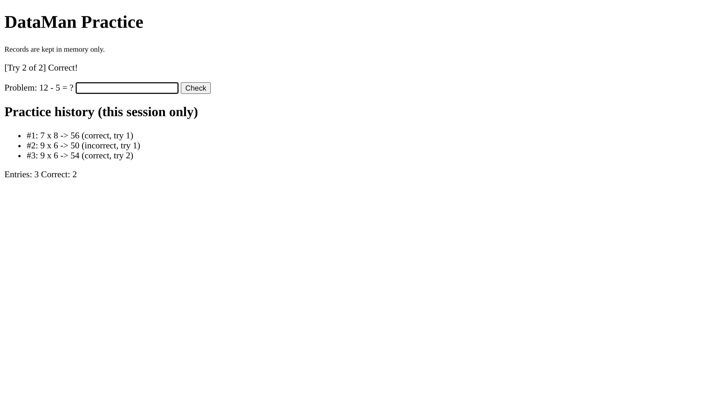

# M5 Acceptance Test Evidence: PB-01 / PB-02 in Flask

**Project root:** [`module-5-flask/`](../../module-5-flask/). All commands were run from that folder on 2026-11-09 (Python 3.13, Flask 3.1.3), against the dev server started with:

```bash
python -m flask --app app run --debug --host=0.0.0.0
```

## What was tested and where it comes from

| Item | Source |
|---|---|
| Slice | PB-01 "Know whether my answer is correct" (FR-01) and PB-02 "My practice history is tracked" (FR-02). See [`product-backlog.md`](../product-backlog.md) and [`requirements.md`](../requirements.md). |
| Criterion carried from M4 | **PB-02 criterion 3:** a learner submits three answers (two correct, one incorrect). The tracked history has three entries, and exactly two are marked correct. Demonstrated in M4 by `prototype/test_criteria.py::test_pb02_criterion_3_three_answers_two_correct`. |
| Related criteria | **PB-01 criteria 1–2:** every submitted answer shows correct or incorrect. **PB-02 criterion 1:** each answer is recorded with the problem it answered. |
| Design decision under test | [`m4-design-investigation-record.md`](../decisions/m4-design-investigation-record.md): one attempt record per answer, the logic owns the try number and recording, and the interface only displays. |
| Settings | `max_tries = 2` (the M4 default, `main.py --tries 2`). Problems come from `default_problems()`: `7 x 8`, `9 x 6`, `12 - 5`. |

## Reuse check

The M4 file `prototype/test_criteria.py` was run against the Module 5 files. Only its two import lines were changed (`data_stub` → `data_store`, `logic` → `business_logic`). Result: **Ran 7 tests, OK** at commits `f3f85f0` and `4ccbe5c`. Before any Module 5 work, the same 7 tests passed against `prototype/` itself.

## Run 1: live server, curl (commit `f3f85f0`)

Each scenario except D starts a new server process, so it begins with an empty in-memory store. Output is trimmed to the message, form label, history and totals. Cookie-jar paths are shortened.

```text
=== A. PB-02 criterion 3 + PB-01 criteria 1-2: three answers, two correct ===
$ curl localhost:5000/                HTTP 200
  form:    Problem: 7 x 8 = ?
  totals:  Entries: 0   Correct: 0
$ curl -d answer=56 localhost:5000/   HTTP 200
  message: [Try 1 of 2] Correct!
  form:    Problem: 9 x 6 = ?
$ curl -d answer=50 localhost:5000/   HTTP 200
  message: [Try 1 of 2] EEE - Not quite. Try again.
  form:    Problem: 9 x 6 = ?
$ curl -d answer=54 localhost:5000/   HTTP 200
  message: [Try 2 of 2] Correct!
  form:    Problem: 12 - 5 = ?
  history: #1: 7 x 8 -> 56 (correct, try 1)
  history: #2: 9 x 6 -> 50 (incorrect, try 1)
  history: #3: 9 x 6 -> 54 (correct, try 2)
  totals:  Entries: 3   Correct: 2

=== A2. reveal after the last allowed miss, then a re-POST ===
$ curl -d answer=1 localhost:5000/    message: [Try 1 of 2] EEE - Not quite. Try again.
$ curl -d answer=2 localhost:5000/    message: [Try 2 of 2] EEE - The answer is 7.   (no form)
  totals:  Entries: 5   Correct: 2
$ curl -d answer=99 localhost:5000/   HTTP 200, no message, nothing recorded
  totals:  Entries: 5   Correct: 2

=== B. invalid input ===
$ curl -d answer=abc localhost:5000/  message: Please enter a whole number.   Entries: 0
$ curl -d answer=5_6 localhost:5000/  message: [Try 1 of 2] Correct!
  history: #1: 7 x 8 -> 56 (correct, try 1)                                   <-- defect

=== C. server process restart ===
$ curl -d answer=56 localhost:5000/   Entries: 1   Correct: 1
# stop the server process and start a new one
$ curl localhost:5000/                form: Problem: 7 x 8 = ?   Entries: 0   Correct: 0

=== D. --debug reloader after a code file is saved ===
$ curl -d answer=56 localhost:5000/   Entries: 1   Correct: 1
# touch app.py   (log: "Detected change in 'module-5-flask/app.py', reloading")
$ curl localhost:5000/                form: Problem: 7 x 8 = ?   Entries: 0   Correct: 0

=== E. two browsers / a stale page share one learner ===
# browser A opens the page
$ curl -c A.jar -b A.jar localhost:5000/                 form: Problem: 7 x 8 = ?
# browser B answers the first problem
$ curl -c B.jar -b B.jar -d answer=56 localhost:5000/    message: [Try 1 of 2] Correct!
# browser A, still showing '7 x 8 = ?', submits 56
$ curl -c A.jar -b A.jar -d answer=56 localhost:5000/
  message: [Try 1 of 2] EEE - Not quite. Try again.
  history: #1: 7 x 8 -> 56 (correct, try 1)
  history: #2: 9 x 6 -> 56 (incorrect, try 1)                                 <-- wrong problem
  totals:  Entries: 2   Correct: 1

server log: 10 x "GET / HTTP/1.1" 200, 12 x "POST / HTTP/1.1" 200
```

## Run 2: after the parse fix (commit `4ccbe5c`)

```text
$ curl -d answer=5_6 localhost:5000/  message: Please enter a whole number.   Entries: 0   Correct: 0
$ curl -d answer=56 localhost:5000/   message: [Try 1 of 2] Correct!          Entries: 1   Correct: 1
```

## Run 3: real browser (Playwright + Chromium, commit `4ccbe5c`)

The browser filled the form and clicked **Check** for each answer.

```text
open: Problem: 7 x 8 = ?
typed 56 -> [Try 1 of 2] Correct! | next: Problem: 9 x 6 = ?
typed 50 -> [Try 1 of 2] EEE - Not quite. Try again. | next: Problem: 9 x 6 = ?
typed 54 -> [Try 2 of 2] Correct! | next: Problem: 12 - 5 = ?
history:
  #1: 7 x 8 -> 56 (correct, try 1)
  #2: 9 x 6 -> 50 (incorrect, try 1)
  #3: 9 x 6 -> 54 (correct, try 2)
Entries: 3   Correct: 2
```



## Results

| Check | Result | Classification if it differs |
|---|---|---|
| **PB-02 criterion 3:** 3 answers (2 correct, 1 incorrect) give 3 entries, 2 correct | **PASS** (curl and browser) | — |
| PB-01 criteria 1–2: every answer shows correct or incorrect | **PASS** | — |
| Try number and reveal come from the logic, not the interface | **PASS**: `Try 2 of 2` and `The answer is 7.` | — |
| Invalid input rejected and not recorded | `abc` **PASS**; `5_6` **FAIL** at `f3f85f0`, **PASS** at `4ccbe5c` | Coding defect (fixed) |
| PB-02 criterion 1: answer recorded with the problem it answered | **FAIL** in Scenario E (stale page) | State/data problem from an unresolved source question. See the finding. |
| History after server restart or `--debug` reload | Emptied (C, D) | Expected at this stage: PB-02 criterion 7 puts persistence in PB-04a/b, which are Not Ready |
| Re-POST after all problems finished (A2) | Not recorded, no crash, but no message shown | Minor gap, noted only |
