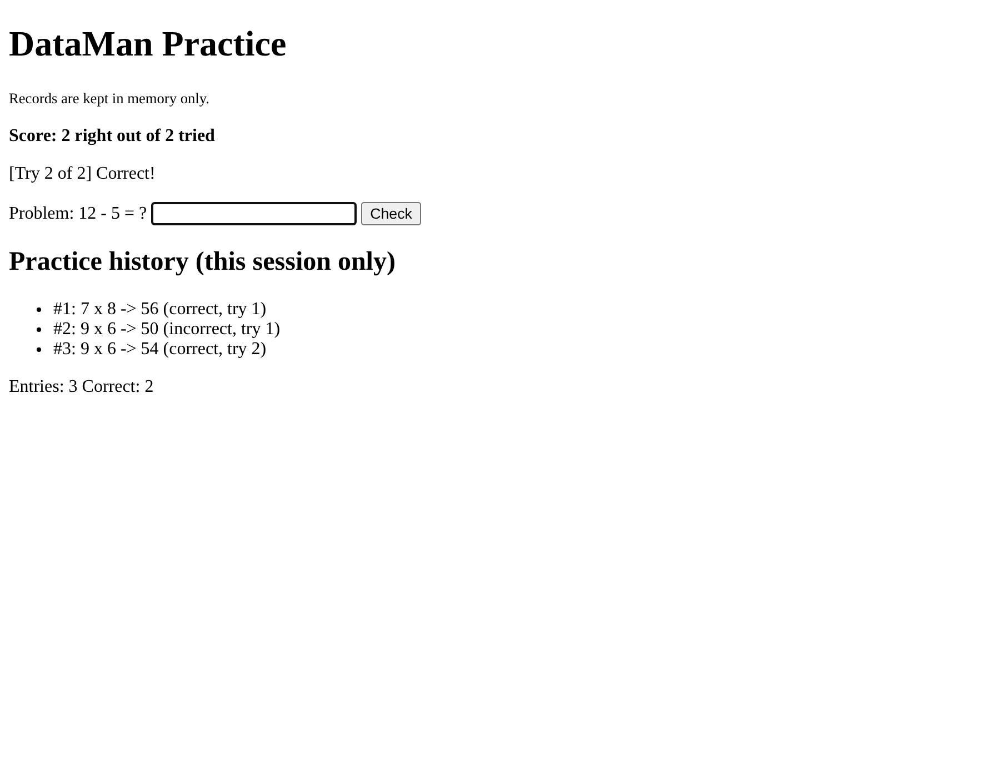
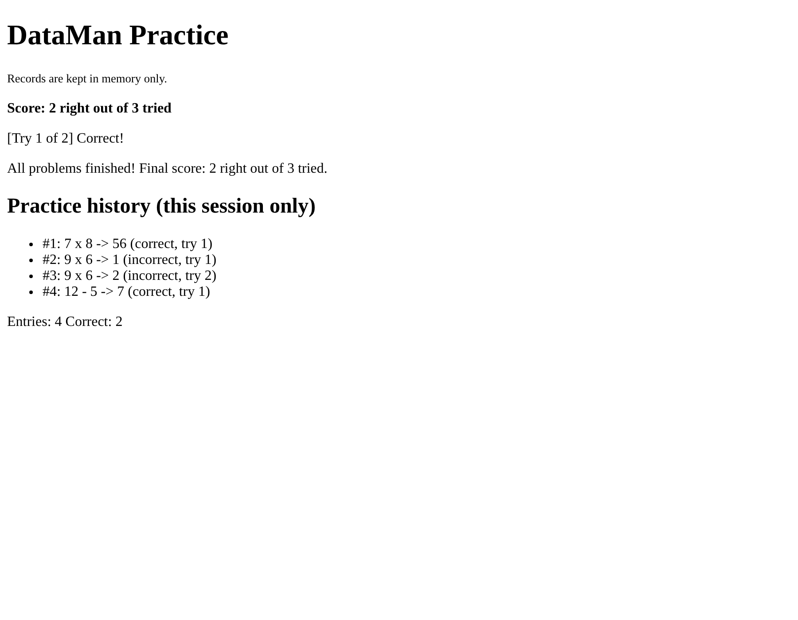

# M5 Extension Test Evidence: PB-03 "See my current score"

**Project root:** [`module-5-flask/`](../../module-5-flask/). Run on 2026-11-23 with Python 3.13 and Flask 3.1.3. Plan and score rule: [`m5-pb03-feature-brief.md`](../design/m5-pb03-feature-brief.md). Decision: [`m5-pb03-implementation-decision.md`](../decisions/m5-pb03-implementation-decision.md).

```bash
python -m unittest discover -s tests -v                        # automated suite
python -m flask --app app run --debug --host=0.0.0.0           # live runs below
```

## Test suite by purpose

| File | Kind of evidence | Tests | When it was committed |
|---|---|---|---|
| `tests/test_m4_criteria.py` | Change impact: M4 PB-01/PB-02 criteria at the logic layer | 7 | Before PB-03 (`6a22562`) |
| `tests/test_flask_baseline.py` | Change impact: M5 Scenarios A, A2 and B through Flask | 3 | Before PB-03 (`6a22562`) |
| `tests/test_pb03_score.py` | Feature: PB-03 #2–#4 and the score rule, at the logic layer | 11 | With the logic (`8e2c9d3`) |
| `tests/test_flask_pb03.py` | Feature: PB-03 #1–#4 and the final score, through Flask | 4 | With the template (`cf672d6`) |
| `tests/test_scenario_e_stale_page.py` | Change impact: retest of the known M5 defect | 4 | Failing first (`d7c0d77`), then fixed (`422952b`) |

| Commit | Result |
|---|---|
| `6a22562` (baseline, no PB-03 code) | 10 run, **OK** |
| `8e2c9d3` (score logic) | 21 run, **OK**. All 10 baseline tests unchanged and passing. |
| `cf672d6` (score on the page) | 25 run, **OK** |
| `d7c0d77` (Scenario E test added) | 25 OK + **1 expected failure** (the defect) |
| `422952b` (stale-page fix) | 29 run, **OK** |

## Feature evidence: real browser (Playwright + Chromium, commit `422952b`)

The browser typed each answer and clicked **Check**.

```text
=== PB-03 #1-#4, desktop 900x700 ===
open: Problem: 7 x 8 = ? | Score: 0 right out of 0 tried
saw "7 x 8", typed 56 -> [Try 1 of 2] Correct!                 | Score: 1 right out of 1 tried
saw "9 x 6", typed 50 -> [Try 1 of 2] EEE - Not quite. Try again. | Score: 1 right out of 1 tried
saw "9 x 6", typed 54 -> [Try 2 of 2] Correct!                 | Score: 2 right out of 2 tried
history: #1 7 x 8 -> 56 (correct, try 1) | #2 9 x 6 -> 50 (incorrect, try 1) | #3 9 x 6 -> 54 (correct, try 2)
Entries: 3 Correct: 2

=== same sequence, phone viewport (Pixel 7 emulation) ===
identical lines to the desktop run

=== Memory Bank final score ===
saw "7 x 8",  typed 56 -> [Try 1 of 2] Correct!                    | Score: 1 right out of 1 tried
saw "9 x 6",  typed 1  -> [Try 1 of 2] EEE - Not quite. Try again.  | Score: 1 right out of 1 tried
saw "9 x 6",  typed 2  -> [Try 2 of 2] EEE - The answer is 54.     | Score: 1 right out of 2 tried
saw "12 - 5", typed 7  -> [Try 1 of 2] Correct!                    | Score: 2 right out of 3 tried
                          | All problems finished! Final score: 2 right out of 3 tried.
Entries: 4 Correct: 2
```

| Desktop, after 56 / 50 / 54 | Final score |
|---|---|
|  |  |

Phone viewport: [`m5-pb03-score-phone.png`](m5-pb03-score-phone.png).

## Change-impact evidence: Scenario E (stale page)

The M5 finding left this defect open. I retested it because the score now reads the same records.

**Before the fix (commit `cf672d6`), two tabs on one learner:**

```text
tab1: Problem: 7 x 8 = ? | tab2: Problem: 7 x 8 = ?
tab1 saw "7 x 8", typed 56 -> [Try 1 of 2] Correct!                    | Score: 1 right out of 1 tried
tab2 saw "7 x 8", typed 56 -> [Try 1 of 2] EEE - Not quite. Try again.  | Score: 1 right out of 1 tried
tab1 saw "9 x 6", typed 50 -> [Try 2 of 2] EEE - The answer is 54.     | Score: 1 right out of 2 tried
history: #1 7 x 8 -> 56 (correct, try 1) | #2 9 x 6 -> 56 (incorrect, try 1) | #3 9 x 6 -> 50 (incorrect, try 2)
```

The learner made one real miss on `9 x 6`, but the answer was revealed and the score dropped a point. Tab 2 also called a correct `7 x 8` answer wrong.

**Triggers I tried in Chromium before fixing:**

| Trigger | Result | Server log |
|---|---|---|
| Double-click **Check** | Not a trigger: one answer recorded | 1 POST |
| Back button, then resubmit | Not a trigger: Chromium re-requested the page, so it showed the real current problem | GET after each back |
| Two tabs, same learner | **Trigger** (above) | — |

**After the fix (commit `422952b`), same steps:**

```text
tab1 saw "7 x 8", typed 56 -> [Try 1 of 2] Correct!                                      | Score: 1 right out of 1 tried
tab2 saw "7 x 8", typed 56 -> That problem is already finished. Here is your next problem. | Score: 1 right out of 1 tried
tab1 saw "9 x 6", typed 50 -> [Try 1 of 2] EEE - Not quite. Try again.                    | Score: 1 right out of 1 tried
history: #1 7 x 8 -> 56 (correct, try 1) | #2 9 x 6 -> 50 (incorrect, try 1)
```

**Old request contract (curl, no `problem_id`) after the fix:** `56`, `56` still records `#2: 9 x 6 -> 56 (incorrect, try 1)`. This is deliberate and covered by `test_request_without_problem_id_keeps_old_behavior`. See the decision note.

Live server log over these runs: 11 × `GET / 200`, 17 × `POST / 200`, no errors.

## Results

| Check | Result | Classification if it differs |
|---|---|---|
| **PB-03 #1** score visible during practice | **PASS** (test client, desktop, phone viewport) | — |
| **PB-03 #2** an incorrect answer does not increase it | **PASS** (`50` leaves `1 right out of 1 tried`) | — |
| **PB-03 #3** 2 correct + 1 incorrect: score reflects the 2 correct | **PASS**: `2 right out of 2 tried` | — |
| **PB-03 #4** updates after a correct answer, no navigation | **PASS**: same page, same POST | — |
| **PB-03 #5** first-time learner understands it unaided | **Not tested.** Needs a child. By inspection the score is labelled text, but it sits beside `Entries: 4 Correct: 2`, which counts attempts, not problems. | Open question (see decision note) |
| **PB-03 #6** all NFR-03 devices | **Partial**: one Chromium build, desktop and phone viewport only | Not tested on a Chromebook, tablet or other browsers |
| Uncertainty: pending retry counted as tried? | Not counted. A try-1 miss keeps `1 right out of 1 tried`. | Design decision, kept |
| Correct attempts vs problems right | Can differ: logic test gives 2 correct attempts, 1 problem right | The score counts problems, kept |
| **Change impact:** PB-02 #3 and M4 criteria | **PASS**, unchanged (10/10 baseline) | — |
| **Change impact:** A2 re-POST after the end | Now shows the final score (was blank) | Minor gap closed |
| **Change impact:** Scenario E stale tab | **FAIL** before the fix: a lost retry and a lower score. **PASS** after `422952b`. | State/data problem, revised |
| History and score after a server restart | Both emptied, as before | Expected: persistence is PB-04a/b |
