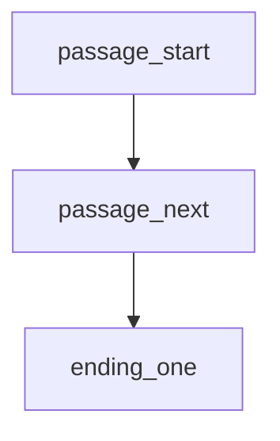

# Story Brief — M3A

- Your name: William Beckham III
- Story title: 
- Route (Python / C++ / Twee): Python

---

## 1. Player evidence

Your player is one real person: a classmate, a friend, or a family member.
Interview them. Write their words. Do not argue. Do not fix.

- Player name: 

| ID | Question | Their answer |
|---|---|---|
| E-01 | What kind of stories do you like? | |
| E-02 | How many minutes do you want to play? | |
| E-03 | What do you not like in a story game? | |
| E-04 | How do you want it to end? | |
| E-05 | Where will you play (phone, laptop, terminal)? | |
| E-06 | What's a place or situation you'd want to be stuck in, and what would you want to find there? | |

---

## 2. User stories

Write 4 to 6. Use this shape:

> As a **[kind of player]**, I want **[an action]**, so that **[a reason]**.

Each story must point to an answer in part 1. If it does not, delete it.

| ID | User story | Evidence |
|---|---|---|
| US1 | | |
| US2 | | |
| US3 | | |
| US4 | | |
| US5 | | |

---

## 3. Acceptance checks

Write one check for each story. A check names something you can see or count while you play.

Weak: "The game is fun."
Strong: "I can reach an ending in 4 choices or fewer."

| Story | Check | Pass / Fail (fill in after you build) |
|---|---|---|
| US1 | | |
| US2 | | |
| US3 | | |
| US4 | | |

---

## 4. Budget and cut list

Your budget is **8 to 12 passages**.

Put your stories in order of value to your player. Keep what fits. Cut the rest.

**Keep**

| Order | Story | Why it is first (or next) |
|---|---|---|
| 1 | | |
| 2 | | |
| 3 | | |

**Cut list** (at least one)

| Story | Why it waits | What would bring it back |
|---|---|---|
| | | |

"Later" is not a reason. Name the condition.

---

## 5. Story map

Draw boxes and arrows on paper and add a photo, or write a Mermaid map.
Mark the start passage. Mark every ending.

| Passage name | What happens | Links to |
|---|---|---|
| passage_start | | |
| | | |

---

## Planning gate

Show parts 1 to 5 to your player. Ask: "Is this a story you would play?"

- [ ] My player said yes.
- [ ] Every user story has evidence and an acceptance check.
- [ ] My map has a start and at least 2 endings.

Do not write code until all three boxes are ticked.

---

## 6. Ask before you build

**My question** (one thing I do not know yet):

**Evidence I used** (map, table, or short test run):

**What the evidence showed:**

**Decision** (Ready / Revise / Split / Hold):

**One sentence why:**

If your question is about something the player carries or remembers, use this table:

| What it is | Where it changes | Where it is read |
|---|---|---|
| | | |

---

## 7. Where each job lives

Write one sentence for each. You do not have to move any code.

- **Shows text** (print and input):
- **Applies rules** (decides what happens next):
- **Holds the story** (the passage words):

---

## 8. Decision after the playtest

- `story_check.py` findings left: 
- Acceptance checks passed: __ of __
- Where my player stopped or looked confused:

**Decision** (Accept / Revise):

**Evidence:**
