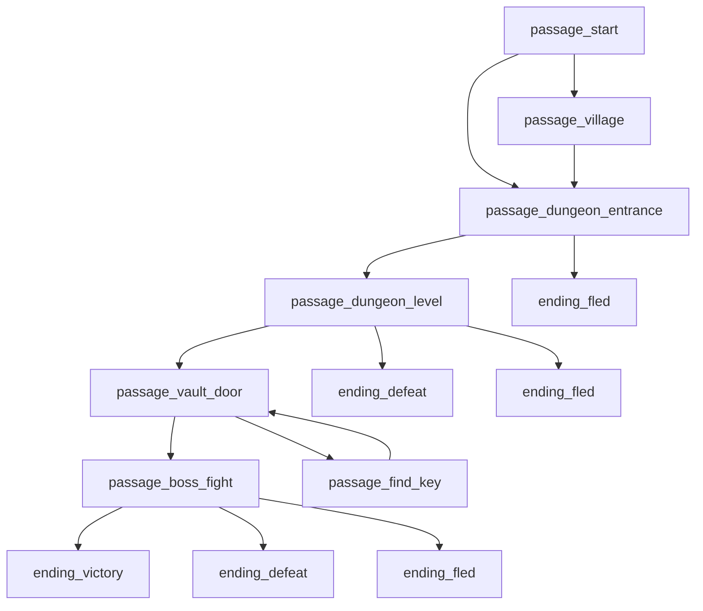

# Story Brief — M3A

- Your name: William Beckham III
- Story title: The Sealed Vault (working title — change if you want)
- Route (Python / C++ / Twee): Python

---

## 1. Player evidence

Your player is one real person: a classmate, a friend, or a family member.
Interview them. Write their words. Do not argue. Do not fix.

- Player name: William Beckham III (self-interview — developer and player, no separate player)

| ID | Question | Their answer |
|---|---|---|
| E-01 | What kind of stories do you like? | "this should be akin to dungeons and dragons type playstyle" |
| E-02 | How many minutes do you want to play? | "1-5 hours per session but a mini session could be a single dungeon level so 30 mins at least" |
| E-03 | What do you not like in a story game? | "irrelevant or missing content, like if there is a code for it let's make it work completely, don't leave code unless the feature is real" |
| E-04 | How do you want it to end? | "I want to beat the final boss and clear the dungeon" |
| E-05 | Where will you play (phone, laptop, terminal)? | "laptop or desktop" |
| E-06 | What's a place or situation you'd want to be stuck in, and what would you want to find there? | "A dungeon vault with a locked boss door and loot behind it, also we can implement villages and such in the world map when you're not in the dungeons" |

---

## 2. User stories

Write 4 to 6. Use this shape:

> As a **[kind of player]**, I want **[an action]**, so that **[a reason]**.

Each story must point to an answer in part 1. If it does not, delete it.

| ID | User story | Evidence |
|---|---|---|
| US1 | As a D&D-style player, I want real combat encounters inside the dungeon, so that it feels like a tabletop RPG instead of a text menu. | E-01 |
| US2 | As a player who sometimes only has 30 minutes, I want one dungeon level to be a complete session, so that a short sitting still feels finished. | E-02 |
| US3 | As a player who hates unfinished content, I want every choice and GUI button to lead to a real, working result, so that nothing feels like a stub. | E-03 |
| US4 | As a player, I want a final boss fight that ends the game when I win, so that clearing the dungeon feels like an actual victory. | E-04 |
| US5 | As a desktop player, I want my story choices to actually open and drive the Tkinter GUI, so that I'm not stuck reading a terminal menu the whole time. | E-05 |
| US6 | As a player, I want a locked vault door that needs a key I have to find, plus a village outside the dungeon, so that the world feels bigger than one combat room. | E-06 |

---

## 3. Acceptance checks

Write one check for each story. A check names something you can see or count while you play.

Weak: "The game is fun."
Strong: "I can reach an ending in 4 choices or fewer."

| Story | Check | Pass / Fail (fill in after you build) |
|---|---|---|
| US1 | I fight at least one real combat encounter (not skipped/simulated) before any ending. | |
| US2 | I can enter the dungeon, clear it, and reach an ending in one sitting of 30 minutes or less. | |
| US3 | Every choice/button reachable in the story leads to a real result — no "coming soon" or silently-ignored clicks. | |
| US4 | Beating the final boss calls `ending_victory` and the game stops there. | |
| US5 | At least one passage opens or drives the Tkinter GUI window, not just printed text. | |
| US6 | The vault door stays locked until I have the key item, and I can visit a village passage before the dungeon. | |

---

## 4. Budget and cut list

Your budget is **8 to 12 passages**.

Put your stories in order of value to your player. Keep what fits. Cut the rest.

**Keep**

| Order | Story | Why it is first (or next) |
|---|---|---|
| 1 | US4 (final boss / ending) | No ending, no game — the whole point per E-04. |
| 2 | US1 (real combat) | The core D&D feel (E-01) the rest is built around. |
| 3 | US6 (locked vault + village) | Directly named by E-06; gives the map more than one room. |
| 4 | US5 (GUI actually drives the story) | E-05 says desktop/laptop — the GUI is already built, just needs wiring. |
| 5 | US3 (no stub content) | A constraint on everything else, not a separate passage. |
| 6 | US2 (30-min session) | Satisfied by scoping the dungeon to one level, not new passages. |

**Cut list** (at least one)

| Story | Why it waits | What would bring it back |
|---|---|---|
| Multiple villages / a full overworld map | The 8-12 passage budget only supports one village hub and one dungeon, not a traveling world map. | If I extend this past the bonus deadline, a second dungeon + second village would be the next add. |
| Merchant buy/sell economy wired into the story passages | `models/merchant.py` already exists in the game code, but hooking it into a graded passage would spend budget on a side system instead of the boss/vault/combat path E-04 and E-06 actually asked for. | Add a `passage_village_shop` once the core 8-12 graph is built and checked clean, as a stretch hook. |

---

## 5. Story map

Draw boxes and arrows on paper and add a photo, or write a Mermaid map.
Mark the start passage. Mark every ending.

| Passage name | What happens | Links to |
|---|---|---|
| passage_start | Intro. Choice: go to the village first, or head straight to the dungeon. | passage_village, passage_dungeon_entrance |
| passage_village | Stock up outside the dungeon (uses the existing GUI). One way out. | passage_dungeon_entrance |
| passage_dungeon_entrance | Choice: descend, or turn back. | passage_dungeon_level, ending_fled |
| passage_dungeon_level | Runs the existing GUI dungeon crawl (movement, rooms, combat) for one level. | passage_vault_door, ending_defeat, ending_fled |
| passage_vault_door | Locked door (H1 state: `has_key`). Choice: unlock (if has_key), or go find the key. | passage_boss_fight, passage_find_key |
| passage_find_key | Side path; sets `has_key = True`. | passage_vault_door |
| passage_boss_fight | Runs the existing GUI combat window against the final boss. | ending_victory, ending_defeat, ending_fled |
| ending_victory | Boss beaten, dungeon cleared — E-04. | (none) |
| ending_defeat | Character died in combat. | (none) |
| ending_fled | Player backed out or fled a fight. | (none) |

---

## Planning gate

Show parts 1 to 5 to your player. Ask: "Is this a story you would play?"

- [ ] My player said yes.
- [ ] Every user story has evidence and an acceptance check.
- [ ] My map has a start and at least 2 endings.

Do not write code until all three boxes are ticked.

---

## 6. Ask before you build

**My question** (one thing I do not know yet): Can `story_check.py`'s passage/ending graph work on top of the existing multi-file Tkinter RPG (`game/`), or does the GUI have to be rewritten to fit the simple branching-function style?

**Evidence I used** (map, table, or short test run): Read `story_check.py`'s `read_python()` — it only opens the one file path you hand it, strips comments/strings, then regex-scans for `def passage_X(` / `def ending_X(` and, inside each function body, literal calls like `passage_Y(` or `ending_Y(`. It never looks at any other file.

**What the evidence showed:** The checker doesn't care what a passage function does internally — only that the passage/ending names it calls are written literally in that one file's text. A `passage_dungeon_level()` function can import `game.main` and launch the whole Tkinter window, run the crawl, then call `passage_vault_door()` or `ending_defeat()` once the GUI returns a result, and the checker will still trace that edge correctly.

**Decision** (Ready / Revise / Split / Hold): Ready.

**One sentence why:** A new `story.py` holding just the `passage_`/`ending_` functions, each one importing and driving a slice of the existing `game/` package, satisfies the checker without touching the RPG's own architecture.

| What it is | Where it changes | Where it is read |
|---|---|---|
| "has a key" | A real `Thieves' Tools` item added to `_player`'s inventory in `passage_find_key` (not a separate flag - the game already tracks this for real) | `_player.has_item_named("Thieves' Tools")`, checked in `passage_vault_door` to allow the "pick the lock" choice |

---

## 7. Where each job lives

Write one sentence for each. You do not have to move any code.

- **Shows text** (print and input): `ask()` and the `print()` calls inside each `passage_`/`ending_` function in `story.py` for the narrated beats; the actual dungeon crawl and combat are shown by the real Tkinter GUI in `game/gui/` once `run_dungeon_gui()`/`run_boss_fight_gui()` hand control to it.
- **Applies rules** (decides what happens next): the `if`/`elif` branches in each passage function in `story.py` (which passage/ending comes next), plus the game rules themselves in `game/models/` (combat math, leveling, loot, vault locking).
- **Holds the story** (the passage words): the `print()` strings inside `story.py`'s passage/ending functions. The RPG's own flavor data (item names, enemy names) lives in `game/data/*.json`.

---

## 8. Decision after the playtest

- `story_check.py` findings left: 
- Acceptance checks passed: __ of __
- Where my player stopped or looked confused:

**Decision** (Accept / Revise):

**Evidence:**
